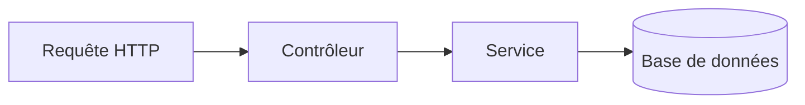

# Modèle de fiche — Bibliothèque (v3)

Une fiche = **une notion**. Le modèle comprend un **tronc commun** (champs, corps, sources, contrôle) valable pour tous les parcours, une **variante par parcours** (§ 3), trois dimensions techniques (**illustrations**, **ateliers Python**, **labs téléchargeables**) et, depuis la v3, des consignes de rédaction pour les **tableaux** et les **schémas** (§ 2.2 et § 2.3) ainsi qu'une liste de **ce qu'il ne faut pas écrire** (§ 2.4).

Parcours couverts : Design / graphisme · Développement Web · Développement Python · Administration réseau · Linux · Cybersécurité.

Règles issues du code : `schema.prisma` (`Entry`, `EntrySource`, `EntryImage`, `EntryLab`), `CreateEntryDto`, `EntrySourceDto`, `quiz-eligibility.ts`, `EntryMdx.tsx`, `entryChecks.ts`, `Playground.tsx`, `sandpack.ts`, `PythonPlayground.tsx`.

Changements de la v3 : sections « Pourquoi c'est utile » → « Contexte » et « Points à retenir » → « À retenir » (calques de l'anglais, § 2.4) ; exemple de titre sans deux-points ; ajout des § 2.2, 2.3 et 2.4.

---

## 1. Fiche d'identité (champs du formulaire)

| Champ du formulaire | Colonne / règle | Valeur à saisir |
| --- | --- | --- |
| Catégorie parente | `categoryId`, obligatoire, **fixée à la création** (jamais modifiable ensuite) | `[Leçon] / [Catégorie]` |
| Titre | `title`, obligatoire, 2 caractères minimum | `[Notion nommée précisément, domaine compris]` |
| Type | `kind`, obligatoire : Fonction / Composant / Concept | selon le parcours, voir § 3 (**Concept** par défaut) |
| Résumé | `summary`, texte libre, vide par défaut | `[Une phrase : ce que la fiche permet de comprendre ou de faire]` |
| Corps | `bodyMdx`, **80 caractères minimum** (espaces de bord exclus) pour qu'un examen puisse être généré | voir § 2 |
| Difficulté | `difficulty` : Débutant (défaut) / Intermédiaire / Avancé | `[choisir]` |
| Étiquettes | `tags`, liste séparée par des virgules | `[parcours, notion, outil]` |
| Sources | table `EntrySource`, 10 maximum, ordre = ordre d'affichage | voir § 4 |
| Vérifiée le | `verifiedOn`, date `AAAA-MM-JJ` | **vide** tant qu'aucune relecture réelle n'a eu lieu |
| Version vérifiée | `verifiedVersion`, 60 caractères maximum | `[version du logiciel, du langage ou du référentiel]` ou vide |
| Illustrations | table `EntryImage`, max 20, ordre alphanumérique (serveur) | voir § 3.5 |
| Atelier Python | `template`, `playgroundInput`, `playgroundExpectedOutput` | **Python uniquement**, voir § 3.6 |
| Modèle Sandpack, fichiers, dépendances | `template`, `files`, `dependencies` | vides pour un Concept ; renseignés seulement pour un playground (§ 3) |
| Lab téléchargeable | `EntryLab` : outil, hôtes, ressources, étapes, fichiers texte | optionnel, voir § 5 |
| Publié | `published`, `false` par défaut | **décoché** : tout est créé en brouillon |

Calculé par le serveur, jamais saisi : `slug`, `position`, `id`, dates de création et de modification.

### Points d'attention

- **Titre = adresse publique.** Le slug (`/entries/<slug>`) est dérivé du titre et **unique dans tout le catalogue, tous parcours confondus** (409 « Ce slug est déjà utilisé » sinon). Avec six domaines, les collisions sont probables : « Les permissions », « Le pare-feu », « Les variables », « Les sélecteurs », « Le chiffrement » existent dans plusieurs parcours. Le domaine figure donc dans le titre : « Permissions sous Linux », « Variables en Python », « Pare-feu et filtrage du trafic réseau ». Le titre suit les règles du § 2.4 (pas de deux-points, une majuscule en tête seulement). Modifier le titre **change l'adresse** de la fiche.
- **Étiquettes.** La recherche par étiquette est une égalité exacte : une seule graphie par notion dans tout le catalogue. Convention proposée : minuscules, sans accent, au singulier ; **première étiquette = parcours** (`design`, `web`, `python`, `reseau`, `linux`, `cybersecurite`). À aligner sur les 35 fiches déjà créées avant de la figer.
- **Vérifiée le / Version vérifiée.** Déclarations de relecture face à la source, jamais pré-remplies ni déduites de la date de modification. Une date dans le futur est refusée.

---

## 2. Corps de la fiche (à coller dans « Corps »)

### 2.1 Contraintes du rendu (`EntryMdx`)

- Markdown + GFM (tableaux, listes de tâches). **Aucun HTML** : `<!-- -->`, `<details>`, `<br>`, `<span>`, `style="…"` s'affichent comme du texte brut. Aucune couleur ni bordure ne se règle depuis le corps : la charte du site s'applique seule.
- Le titre est déjà affiché en `h1` : le corps commence par `##`.
- Tout bloc de code porte son langage (`bash`, `powershell`, `python`, `html`, `css`, `js`, `mermaid`, `text`…) ; sans langage, la coloration suppose `ts`. Un résultat affiché se met dans un bloc `text`.
- **Images** : voir § 3.5 (images uploadées) ; lien format `/media/<uuid>` seulement, les autres deviennent « Image non affichée ».
- **Tableaux** : voir § 2.2. **Schémas** : voir § 2.3.
- Les sources ne figurent **pas** dans le corps : le bloc « Sources » est généré depuis la liste du § 4.
- Repère éditorial (pas une règle du code) : environ 1 200 à 4 000 caractères. Chaque point à retenir est une phrase complète, car l'examen de 4 questions est généré à partir du seul texte de la fiche.
- Marqueurs : `[À COMPLÉTER : …]` pour tout emplacement non rempli (permet de contrôler qu'aucun ne subsiste), `[À VÉRIFIER]` pour un fait incertain.
- Ton impersonnel (« la commande affiche… », « il convient de… »), ni « tu » ni « vous ».

### Gabarit

````markdown
## Objectif

À l'issue de cette fiche, il est possible de :

- [À COMPLÉTER : verbe d'action + résultat observable, ex. « identifier… », « écrire… », « configurer… », « choisir… »]
- [À COMPLÉTER : 1 à 3 objectifs ; le nombre suit le contenu de la fiche, pas un quota]

**Prérequis** : [À COMPLÉTER : titre de la fiche existante concernée, ou « aucun »]

## Contexte

[À COMPLÉTER : situation réelle du métier visé qui rend la notion nécessaire. 2 à 4 phrases, en partant du cas concret.]

## L'essentiel

[À COMPLÉTER : explication de la notion, du plus simple au plus précis. Définir chaque terme technique à sa première apparition.]

Un **[terme]** désigne [À COMPLÉTER : définition en une phrase].

### [À COMPLÉTER : sous-notion, si nécessaire]

[À COMPLÉTER : texte, liste numérotée pour une procédure.]

[À COMPLÉTER : phrase qui annonce le tableau et dit ce qu'il compare.]

| [Élément comparé] | [Critère 1] | [Critère 2] |
| :--- | :---: | ---: |
| [À COMPLÉTER] | [À COMPLÉTER] | [À COMPLÉTER] |

> **Erreur fréquente.** [À COMPLÉTER : un piège courant et la manière de l'éviter. Supprimer ce bloc s'il n'y en a pas.]

## Exemple concret

[À COMPLÉTER : mise en situation tirée du quotidien du métier visé, en 2 à 4 phrases.]

```text
[À COMPLÉTER : code, commande, configuration ou valeurs. Remplacer « text » par le langage réel.]
```

```text
[À COMPLÉTER : résultat obtenu, si utile]
```

[À COMPLÉTER : ce que fait chaque élément de l'exemple, ligne par ligne ou valeur par valeur.]

## Exercice

[À COMPLÉTER : énoncé court, réalisable en 5 à 10 minutes, qui réutilise l'exemple.]

1. [À COMPLÉTER : consigne]
2. [À COMPLÉTER : consigne]

### Correction

[À COMPLÉTER : réponse attendue et raisonnement. La correction suit l'énoncé : le rendu n'a pas de bloc repliable.]

## À retenir

- [À COMPLÉTER : phrase complète, compréhensible seule]
- [À COMPLÉTER : le nombre de points suit le contenu (en général 3 à 5)]
- [À COMPLÉTER : inclure les valeurs, commandes ou seuils à connaître]
````

Les six sections (Objectif, Contexte, L'essentiel, Exemple concret, Exercice, À retenir) sont obligatoires et gardent cet ordre. Le bloc « Erreur fréquente », le tableau, le schéma, la sous-section `###` et le bloc de résultat sont facultatifs : une partie non utilisée est supprimée, jamais laissée vide.

### 2.2 Rédiger un tableau

Un tableau sert à **comparer** des éléments sur les mêmes critères (valeurs, options, commandes, niveaux). Pour une simple énumération, une liste suffit.

À faire :

- Annoncer le tableau par une phrase qui dit ce qu'il compare ; le tableau ne remplace pas l'explication.
- Écrire la ligne d'en-tête et la ligne de séparation : sans elles, le tableau n'existe pas.
- Placer dans la **première colonne** l'élément comparé (il sert d'étiquette de ligne).
- Aligner par la ligne de séparation : `:---` à gauche (texte), `:---:` centré, `---:` à droite (nombres, durées, tailles).
- Garder le tableau compact : 5 colonnes et 8 lignes au plus, cellules courtes (quelques mots, une valeur). Au-delà, scinder en deux tableaux.
- Donner **le même nombre de cellules à chaque ligne**. Une ligne de longueur différente fait échouer le rendu du tableau (erreur « Cell count must match column count » constatée en test ; effet exact sur la fiche entière non vérifié, à contrôler dans l'aperçu).
- Remplir toute cellule ; une case sans objet se note « — », jamais vide.
- Échapper une barre verticale dans une cellule : `\|` (fréquent dans les commandes shell avec un pipe).
- Mettre en valeur par du **gras** ou du `code` en ligne seulement.
- Citer exactement les mêmes chiffres, unités et termes que le texte autour.

À ne pas faire :

- Mettre une liste, un bloc de code ou un saut de ligne dans une cellule : `<br>` et le HTML s'affichent en texte brut.
- Espérer une couleur, une bordure ou un fond de cellule : aucune syntaxe ne le permet depuis le corps.
- Utiliser un tableau pour mettre du texte en page (une seule colonne utile, paragraphes dans les cellules).
- Écrire de longues phrases dans les cellules : sur téléphone, un tableau large défile horizontalement.

Exemple correct :

```markdown
Le tableau compare trois masques courants.

| Masque | Adresses utilisables | Usage typique |
| :--- | ---: | :--- |
| /24 | 254 | Réseau local d'un site |
| /25 | 126 | Sous-réseau d'un service |
| /30 | 2 | Liaison entre deux routeurs |
```

### 2.3 Rédiger un graphique (schéma Mermaid)

Le site dessine des **schémas** (organigramme, séquence, états, etc.) à partir d'un bloc ```` ```mermaid ````. Il n'a **pas** de bibliothèque de graphiques de données (barres, courbes) : une série de chiffres se présente dans un tableau. Un `pie` ou un `xychart-beta` Mermaid peut fonctionner, sans garantie dans cette version : à tester dans l'aperçu avant publication, et à remplacer par un tableau si le rendu échoue.

À faire :

- Utiliser un schéma quand les **liens** comptent (flux, enchaînement, hiérarchie, échanges) ; un tableau quand les **valeurs** comptent.
- Annoncer le schéma par une phrase qui dit ce qu'il montre, puis **décrire l'essentiel en texte** juste après : le contenu doit rester compréhensible sans voir le dessin (lecteur d'écran, échec de rendu, examen généré depuis le texte).
- Rester petit : une quinzaine de nœuds au maximum, des libellés courts, un sens de lecture unique (`flowchart LR` ou `TD`).
- Écrire les libellés en texte simple ; mettre entre guillemets tout libellé qui contient une parenthèse, un deux-points ou un caractère spécial (`A["Pare-feu (nftables)"]`).
- Reprendre dans le schéma les mêmes noms et les mêmes valeurs que le texte.
- Contrôler le rendu dans l'aperçu : un schéma qui échoue affiche « Ce schéma n'a pas pu être dessiné » avec sa source, et l'aperçu le signale comme un manque avant publication.

À ne pas faire :

- Ajouter une directive `%%{ … }%%` ou un en-tête YAML (`---`) : refusés avant le rendu.
- Mettre du HTML dans un libellé (`<br>`, `<b>`) : le rendu est en texte simple.
- Ajouter des liens ou des actions de clic : désactivés par le mode strict.
- Régler les couleurs soi-même (`style`, `classDef`) : le site applique sa charte ; l'effet de ces instructions n'a pas été vérifié, elles sont à éviter pour garder la cohérence visuelle.
- Dessiner un schéma décoratif qui ne dit rien de plus que le texte.

Exemple correct :

````markdown
Le schéma suit le trajet d'une requête dans l'API.



La requête arrive au contrôleur, qui la confie au service ; seul le service interroge la base.
````

### 2.4 Ce qu'il ne faut pas écrire

Ces défauts font reconnaître un texte produit en série. Ils valent pour le corps, le résumé et les titres de toutes les fiches.

1. **Une structure et un nombre de puces identiques d'une fiche à l'autre.** Le nombre de puces, de paragraphes et de sections facultatives suit le contenu ; trois puces partout est un signal d'alerte.
2. **Les titres génériques ou marketing et les formules creuses** (« Tout savoir sur… », « Maîtriser X en un clin d'œil », « un outil incontournable », « de nombreux avantages »). Un titre nomme la notion ; une phrase dit un fait.
3. **Les puces au format « Mot-clé : explication ».** Écrire des phrases complètes, qui se comprennent seules. Le gras sert à repérer un terme défini, pas à fabriquer des étiquettes à rallonge.
4. **Les emojis, les icônes décoratives, les images générées par IA** (lumière dorée, scènes trop parfaites). Les images sont des captures réelles ou des schémas utiles à la compréhension (§ 3.5), avec un texte alternatif précis.
5. **Les incohérences de mise en page ou de chiffres.** Une valeur, une unité, un nom de commande s'écrivent de la même façon dans le texte, le tableau, le schéma, l'exemple et la correction. Même ordre et même format pour des éléments de même nature.
6. **Les tournures « Ce n'est pas X, c'est Y ».** Affirmer directement ce qu'est la notion.
7. **Les calques de l'anglais** : « Pourquoi c'est important ? », « Points clés à retenir », « Plongeons dans… », « Dans cet article, nous allons… ». Employer le français courant : « Contexte », « À retenir ».
8. **Les titres avec deux-points et une majuscule à chaque mot.** Titre et intertitres : phrase nominale, majuscule en tête seulement, pas de deux-points (« Pare-feu et filtrage du trafic réseau », pas « Pare-feu : Filtrer Le Trafic Réseau »).

Rappels du tronc commun : ni « tu » ni « vous » ; aucun HTML ; aucun fait sans source ou sans marqueur `[À VÉRIFIER]`.

### 2.5 Consignes à donner à l'IA rédactrice (à coller en tête de la demande)

Une liste d'interdits ne suffit pas : une IA qui évite un tic en prend un autre. Ce qui rend un texte humain, c'est une **situation précise**, un **regard de praticien** et un **rythme irrégulier**. Le bloc ci-dessous donne ces trois choses, puis la liste du § 2.4 sert de contrôle final.

````text
Rôle. Tu rédiges une fiche pour une bibliothèque d'apprentissage, comme le ferait un formateur qui exerce le métier visé depuis des années et qui relit sa propre fiche avant de la donner à un stagiaire. Le texte final est impersonnel (ni « tu » ni « vous » dans la fiche), mais il se lit comme écrit par quelqu'un qui connaît le terrain.

Avant d'écrire, réponds en une phrase chacune (ne les recopie pas dans la fiche) :
1. Quelle situation réelle (un incident, une demande, un dossier) amène quelqu'un à avoir besoin de cette notion ?
2. Quelle erreur un débutant fait-il vraiment sur ce point, et quel symptôme voit-il à l'écran ?
3. Quel détail un manuel oublie-t-il ou rend-il trop abstrait ?

Ensuite, écris en partant de cette situation, pas de la définition.

Ce qui rend le texte humain :
- Un cas précis avant la règle générale : un nom de fichier, une valeur, un message d'erreur réel, un chiffre vérifié, plutôt que « dans certains cas ».
- Des sujets concrets (« l'administrateur », « la commande », « le serveur », « le graphiste ») plutôt que des tournures vagues ; des verbes d'action plutôt que des noms abstraits (« la commande refuse l'accès », pas « un refus d'accès est observé »).
- Un rythme irrégulier : phrases courtes et phrases longues mélangées, paragraphes de longueurs différentes. Une idée par paragraphe. Pas de refrain d'ouverture ou de fermeture identique d'une section à l'autre.
- Des mots du métier, définis une fois, puis employés tels quels ; pas de synonymes de remplissage pour éviter une répétition.
- Un avis de praticien quand il est justifié (« en pratique, c'est la première chose à vérifier », « ce réglage se laisse rarement à sa valeur par défaut »), avec la raison.
- Les limites dites franchement : ce que la fiche ne couvre pas, ce qui varie selon la version, ce qui reste incertain (marqueur `[À VÉRIFIER]`).
- Le nombre de puces, de sections facultatives et de lignes de tableau décidé par le contenu. Si trois idées suffisent, trois ; si une seule compte, une seule.

Ce qui rend le texte artificiel (à éviter, liste complète au § 2.4) : titres marketing, formules creuses, puces « Mot-clé : explication », « Ce n'est pas X, c'est Y », calques de l'anglais, emojis, titres avec deux-points et majuscules, chiffres ou termes qui changent d'un passage à l'autre.

Contrôle final, avant de rendre la fiche :
- Relire à voix haute mentalement : chaque phrase pourrait-elle être dite par un formateur sans paraître récitée ?
- Retirer toute phrase qui pourrait figurer telle quelle dans n'importe quelle autre fiche.
- Vérifier que chaque chiffre, commande et nom propre est identique partout et soit sourcé ou marqué `[À VÉRIFIER]`.
- Ne rien inventer : un exemple, un message d'erreur ou une valeur non vérifiés sont marqués `[À VÉRIFIER]`, jamais présentés comme réels.
````

Exemple de réécriture, pour calibrer l'IA (à joindre à la demande) :

| Version artificielle | Version humaine |
| --- | --- |
| « Les permissions Linux sont un élément fondamental de la sécurité du système. » | « Un script qui refuse de se lancer avec `Permission denied` alors que le fichier existe : dans neuf cas sur dix, c'est un droit d'exécution manquant. » |
| « **Lecture** : permet de lire le fichier. » | « Le droit de lecture (`r`) autorise à ouvrir un fichier et à en lire le contenu ; sur un dossier, il autorise à en lister le contenu. » |
| « Ce n'est pas un simple réglage, c'est une barrière de sécurité. » | « Retirer le droit d'écriture sur un fichier de configuration empêche un compte de service compromis de le modifier. » |

La colonne de gauche est volontairement fautive (formule creuse, puce « Mot-clé : explication », « Ce n'est pas X, c'est Y »). L'exemple « neuf cas sur dix » est une illustration de ton, non un chiffre sourcé : une vraie fiche le remplace par un fait vérifié ou le retire.

---

## 3. Variantes par parcours (avec illustrations, Python, labs)

Le corps garde la même structure ; changent le type, le playground, la forme de l'exemple et de l'exercice.

|  | Type / playground | « Exemple concret » | « Exercice » | Illustrations | Atelier Python | Version vérifiée |
| --- | --- | --- | --- | --- | --- | --- |
| **Design / graphisme** | Concept. Option : **Composant** + modèle `static` pour HTML/CSS | Cas de commande + **valeurs chiffrées** (couleurs, tailles, contraste, marges) en tableau | Production avec contrainte vérifiable (ex. palette 3 couleurs avec contraste contrôlé), correction = critères | Recommandé (palette, interfaces, grilles) ; alt. si absent | Non | `[logiciel]` |
| **Développement Web** | **Concept** pour théorie. **Composant** + `static` pour HTML/CSS ; **Fonction** + `vanilla` pour JS | Bloc `html`, `css` ou `js` complet, exécutable | Modifier le code pour obtenir résultat précis | Optionnel (UI/layout) | Non | `[navigateur / spec]` |
| **Développement Python** | **Concept** uniquement (aucun Sandpack) | Script 10–20 lignes + sortie exacte | Écrire/corriger script ; correction = code + sortie | Non | **Fortement recommandé** : entrée (test case), code, sortie attendue pour vérification | `[Python 3.x]` |
| **Admin réseau** | Concept | Tableau (adresses, masques) ou schéma de topologie, commande `text`/`bash` + résultat | Calcul ou config d'un plan donné | Optionnel (topologie) | Non | `[équipement / RFC]` |
| **Linux** | Concept | Commande `bash` + sortie `text`, exécutée réellement | Manipulation terminal, correction = commandes + résultat | Optionnel (commandes visuelles) | Non | `[distrib, version]` |
| **Cybersécurité** | Concept | Scénario **défensif** (détection, durcissement, pratique) | Analyse ou durcissement ; jamais d'attaque exploitable | Optionnel (logs, config annotée) | Non | `[référentiel / outil]` |

Règles communes :

- Tout fait est sourcé ou marqué `[À VÉRIFIER]`.
- Une fiche qui renvoie à une notion existante cite la fiche au lieu de la répéter.
- Un playground suppose un type ≠ Concept **ET** au moins un fichier.
- **Python** : `playgroundInput` et `playgroundExpectedOutput` sont renseignés si atelier ; sinon vides.
- **Images** : chaque image a un alt obligatoire ; lien format `/media/<uuid v4 minuscule>` seulement.

---

### 3.5. Illustrations (spec 016)

Une fiche peut contenir **jusqu'à 20 images uploadées**. Elles enrichissent l'explication visuelle.

**Modèle `EntryImage`** :

- `entryId` (obligatoire, cascade)
- `imageId` (UUID v4 minuscule, `[a-z0-9]{32}`, immuable)
- `altText` (texte alternatif, 500 chars max, **obligatoire**)
- `uploadedAt` (date/heure, serveur)
- Ordre : ordre d'insertion (serveur)

**Règles de contenu** :

- Format accepté : PNG, JPEG, WebP **seulement** (SVG/GIF/BMP → 400)
- Résolution : max 50 Mpx (50 000 000 pixels = ~7071×7071)
- Encodage : sRGB, **sans métadonnées**
- Budget : 2 versions (lecture ≤1600px/400KB; full ≤3840px/2MB)
- Quotas : 60 uploads/h/compte, 1.8 GB total/compte
- Contenu : captures réelles et schémas utiles ; ni image générée par IA, ni illustration décorative (§ 2.4)

**Dans le corps Markdown** :

```markdown

```

- Si l'id est absent, invalide ou d'une autre fiche → « Image non affichée »
- Les uploads se font dans l'interface admin (pas dans le formulaire texte)

**Taille du fichier** : max 10 MB au téléchargement (serveur refuse le reste)

---

### 3.6. Ateliers Python (spec 017)

**Développement Python uniquement.** Une alternative au playground Sandpack : un éditeur CodeMirror 6 + interpréteur Pyodide dans une iframe sandboxée (aucun réseau, aucune session).

**Modèle `Entry`** :

- `template` : must be `'python'` (not CONCEPT, require files pour affichage)
- `playgroundInput` : entrée standard (stdin), ≤10 000 chars, ligne = `input()`
- `playgroundExpectedOutput` : sortie attendue, ≤10 000 chars ; absent = pas de vérification
- `files` : 30 fichiers max, chacun ≤20 000 chars (ignorés les non-`.py` ou mal nommés)

**Fichier principal** : `main.py` toujours (point d'entrée via `runpy.run_path`)

**Validations** :

- Noms : `^[A-Za-z_][A-Za-z0-9_]*\.py$` seulement
- Pas de dépendances (refusé si `dependencies` n'est pas vide)
- Total fichiers + input + output ≤ 200 000 chars

**À l'affichage** :

- CodeMirror 6 (Tab indente, Escape+Tab quitte)
- Boutons : « Exécuter » (30 s timeout), « Arrêter » (terminate iframe), « Réinitialiser » (effacer output, stdin)
- Si `playgroundExpectedOutput` présent : « Vérifier » (compare stdout, ignore sauts de ligne/espaces de fin)
- Sortie : texte brut, max 200 000 chars ou 10 000 lignes
- Erreurs/timeouts : message français clair (EOFError, ModuleNotFoundError, MemoryError traités)

**Sécurité** : iframe opaque (`src="/python-runner/runner.html"`, `sandbox="allow-scripts"` sans `allow-same-origin`), CSP `connect-src 'none'`, pas de réseau. Python prelude bloque `micropip`, `sys.modules['pyodide.http']`, `importScripts`, `indexedDB`, `Worker`.

**Exemple de structure** (le code d'exemple d'une fiche est écrit en ton impersonnel, comme le corps) :

```python
# main.py
name = input("Nom : ")
print(f"Bonjour, {name} !")
```

- `playgroundInput` : `"Alice"` → sortie : `"Bonjour, Alice !"`

---

## 4. Sources (liste du formulaire, une ligne par document)

Chaque fiche porte sa propre liste. Reformuler, ne jamais recopier ; une fiche tirée d'un document est cochée « adaptée ».

| Champ | Règle | Valeur |
| --- | --- | --- |
| Titre | obligatoire, 200 caractères maximum | `[Titre exact du document]` |
| Adresse (`url`) | obligatoire, **`https://` uniquement**, 2 048 caractères maximum | `[https://…]` |
| Éditeur | 120 caractères maximum | `[organisme ou éditeur]` |
| Consulté le | date `AAAA-MM-JJ`, pas dans le futur | `[date de la consultation réelle]` |
| Licence | 80 caractères maximum | `[ex. CC BY 4.0]` |
| Adresse de la licence | `https://` uniquement | `[https://…]` |
| Adaptée | case « Adapté de » | cochée si la fiche reformule ce document |

Sources à privilégier : documentation officielle de l'outil ou du langage, normes et RFC, organismes publics (ANSSI, CNIL, France Compétences, DINUM), éditeurs de la technologie.

---

## 5. Labs téléchargeables (spec 018)

**Optionnel.** Un lab est un ensemble de **fichiers texte** que l'apprenant télécharge en `.zip` et fait tourner **sur sa propre machine** (machine virtuelle, conteneurs, simulateur réseau). Le site n'exécute rien, n'héberge rien, ne garde aucune trace du téléchargement : l'archive est fabriquée dans le navigateur à partir de la fiche. Le lab complète l'exercice de la fiche ; la fiche reste lisible et utile sans lui.

### 5.1 Champs du formulaire (section « Cette fiche a un laboratoire »)

| Champ | Règle | Valeur |
| --- | --- | --- |
| Outil | obligatoire : Vagrant, Docker Compose, Containerlab, GNS3, Autre | l'outil qui lance le lab (§ 5.3) |
| Laboratoire de sécurité | case ; ajoute l'avertissement d'isolement du réseau et de cadre légal | **cochée** pour tout lab de cybersécurité (et tout lab qui contient des outils de test d'intrusion) |
| Logiciels requis | 300 caractères maximum, signalé comme manque si vide | outils **avec versions** : `Vagrant 2.4, VirtualBox 7.1` |
| Mémoire (Go) | entier de 1 à 128 | mémoire que le lab consomme vraiment, pas une valeur au hasard |
| Disque (Go) | entier de 1 à 500 | espace disque réel, boîtes et images comprises |
| Systèmes hôtes | au moins un : Linux, Windows, macOS | systèmes **de la machine de l'apprenant** sur lesquels le lab a été essayé |
| Étapes de lancement (Markdown) | 5 000 caractères maximum, signalé comme manque si vide | § 5.4 |
| Étapes d'arrêt et de destruction (Markdown) | 3 000 caractères maximum, signalé comme manque si vide | § 5.4 |
| Fichiers | chemin + contenu texte, § 5.2 | § 5.3 |

L'avertissement « À lire avant de lancer » est **fixe** : il s'affiche sur la fiche et dans le `LISEZMOI.txt`, il ne se modifie pas et ne se recopie pas dans le corps.

### 5.2 Règles des fichiers

- Chemins relatifs seulement : lettres, chiffres, `.`, `_`, `-` (64 caractères par composant, 200 au total), 5 niveaux au plus (4 dossiers + le fichier). Pas de `..`, de `:`, de `\`, de chemin absolu, ni de nom réservé Windows (`CON`, `PRN`, `AUX`, `NUL`, `COM1`…, `LPT1`…).
- Fichiers cachés admis : `.env.example`, `.gitignore`, `.vagrant-version`, `.editorconfig`. Aucun autre.
- Limites : 30 fichiers, 50 000 caractères par fichier, 200 000 au total. Pas deux fichiers au même nom à la casse près, pas de fichier qui est aussi un dossier, pas de caractère nul.
- **Texte uniquement** : aucun binaire (image disque, `.box`, `.iso`, archive, exécutable compilé, capture d'écran). Ce qui est lourd est **téléchargé par l'outil** à partir d'une source officielle (image Docker, boîte Vagrant), jamais embarqué.
- Les fichiers `.sh` sont rendus exécutables (`0755`) dans l'archive ; tous les autres sont en `0644`. Un fichier `.ps1` ou `.bat` n'a donc pas de droit particulier, ce qui convient sous Windows.
- L'archive contient un dossier racine `<slug>-laboratoire/` et un `LISEZMOI.txt` **généré** (prérequis, avertissement, lancement, destruction, liste des fichiers). Ne pas écrire de `README` qui le double.

### 5.3 Quel lab pour quel parcours

| Parcours | Outil | Fichiers typiques | Remarques |
| --- | --- | --- | --- |
| **Linux** | Docker Compose (léger) ou Vagrant (système complet, `systemd`, noyau) | `docker-compose.yml` ou `Vagrantfile`, `prepare.sh` (met en place la situation), `solution.sh` (correction), `.env.example` | Docker Compose suffit pour les commandes, droits, processus, texte ; Vagrant devient nécessaire pour les services `systemd`, le disque, le démarrage. |
| **Windows** | Vagrant (machine Windows) ou **Autre** (scripts PowerShell sur la machine de l'apprenant) | `Vagrantfile`, `prepare.ps1`, `solution.ps1` | La boîte Windows est téléchargée par Vagrant (lourde : annoncer le disque) ; un lab de scripts PowerShell doit s'exécuter dans un dossier de test et ne rien modifier hors de lui. |
| **macOS** | **Autre** | scripts `.sh`, fichiers de configuration | Pas de virtualisation de macOS : le lab ne vise que l'hôte macOS, dans un dossier jetable. |
| **Réseau** | Containerlab (topologie en conteneurs, hôte Linux) ou GNS3 | `topologie.clab.yml`, configurations d'équipements (`r1.cfg`…), `verifier.sh` | Un projet GNS3 exporté est une archive binaire : seules les configurations texte peuvent figurer dans le lab (fonctionnement exact de GNS3 à tester, `[À VÉRIFIER]`). Préférer Containerlab pour un lab entièrement en texte. |
| **Cybersécurité** | Docker Compose ou Vagrant, case « sécurité » cochée | réseau isolé, services volontairement mal configurés à **durcir**, `solution.sh` | Scénario défensif : détecter, corriger, durcir. Aucune cible externe, aucun outil lancé hors du réseau du lab. |
| **Python, Web, Design** | rarement utile | le playground (§ 3.6) ou Sandpack couvre le besoin | Un lab ne sert que si l'exercice demande un environnement que le navigateur ne peut pas fournir. |

### 5.4 Écrire les étapes de lancement et de destruction

- **Numérotées, une action par étape**, avec la commande exacte dans un bloc de code et son **résultat attendu** en une ligne (« la commande affiche `running` »). Ces textes sont du Markdown : mêmes règles que le corps (§ 2.1, pas de HTML).
- Étapes **par système hôte** quand elles diffèrent : une sous-liste « Linux et macOS » et une « Windows (PowerShell) ». Ne cocher dans « Systèmes hôtes » que ceux effectivement essayés.
- Lancement : vérifier les prérequis, aller dans le dossier extrait, lancer, vérifier que le lab répond, puis renvoyer à l'exercice de la fiche.
- Destruction : **toujours** une étape qui supprime ce que le lab a créé : `vagrant destroy -f`, `docker compose down -v`, `containerlab destroy -t <fichier>` ; mentionner ce qui reste sur la machine (images et boîtes téléchargées) et comment le retirer.
- Dire ce qui est consommé (mémoire, disque, ports utilisés) et ce qui peut gêner (ports déjà occupés, virtualisation désactivée dans le BIOS).

### 5.5 Sécurité du contenu

Le contenu du lab s'exécute avec les droits de l'apprenant : il se rédige comme du code qui sera lancé chez quelqu'un d'autre.

- Aucune commande qui télécharge puis exécute (`curl … | sh`) ; les versions d'images et de boîtes sont **fixées** (pas de `latest`).
- Aucun secret réel. Les mots de passe d'exemple sont évidemment factices, dans `.env.example`, jamais dans un `.env`.
- Le lab ne touche que son propre dossier et ses propres conteneurs ou machines ; aucune commande qui modifie le système de l'apprenant en dehors du lab.
- Adresses réservées à la documentation (RFC 5737 : `192.0.2.0/24`, `198.51.100.0/24`, `203.0.113.0/24`) ou plages privées internes au lab ; jamais d'adresse réelle d'un tiers.
- Lab de cybersécurité : case « sécurité » cochée, réseau isolé de l'extérieur, aucun outil d'attaque dirigé hors du lab.

### 5.6 Avant de publier

- **Essayé pour de vrai** : lancé depuis l'archive téléchargée, sur une machine propre, jusqu'à la destruction. Un lab non essayé ne se publie pas ; les marqueurs `[À VÉRIFIER]` ne doivent pas rester dans les fichiers ni dans les étapes.
- Le formulaire signale comme manques : aucun fichier, pas d'étapes de lancement, pas d'étapes de destruction, logiciels non précisés. Il rappelle aussi, à **chaque** publication d'une fiche avec lab, de relire les fichiers : seul un `SUPER_ADMIN` publie.
- Le lab apparaît après l'atelier et avant les sources ; il n'apparaît jamais dans la lecture réduite d'une fiche réservée. Les cartes, étapes de parcours et lignes admin portent la mention « Laboratoire ».
- Le corps de la fiche cite le lab là où il sert (dans l'exercice) et dit ce que le lab permet de constater ; il ne recopie pas les fichiers.

### 5.7 Exemple (illustratif, non testé)

Fiche « Permissions sous Linux », lab Docker Compose, hôtes Linux et macOS.

| Champ | Valeur |
| --- | --- |
| Outil | Docker Compose |
| Logiciels requis | `Docker Engine 27 avec Compose v2` (à confirmer sur la machine d'essai) |
| Mémoire / disque | 1 Go / 1 Go |
| Fichiers | `docker-compose.yml`, `prepare.sh`, `solution.sh` |

Étapes de lancement (Markdown) :

````markdown
1. Extraire l'archive et ouvrir un terminal dans le dossier `permissions-sous-linux-laboratoire`.
2. Lancer le conteneur :

   ```bash
   docker compose run --rm lab bash /lab/prepare.sh
   ```

   Le terminal affiche `Situation prête : le script rapport.sh refuse de se lancer.`
3. Corriger le droit manquant en suivant l'exercice de la fiche.
````

Étapes d'arrêt et de destruction :

````markdown
```bash
docker compose down -v
docker image rm debian:12-slim
```

Le conteneur et son volume sont supprimés ; la seconde commande retire l'image téléchargée (environ 75 Mo).
````

Chiffres, noms et commandes de cet exemple à vérifier sur une machine réelle avant tout emploi.

---

## 6. Limites actuelles du site (à connaître avant d'écrire)

1. **Images uploadées, pas de galerie tiers.** Hébergement serveur (UploadThing backend, jamais browser-upload). Format strict, métadonnées effacées, CSP restrictive.
2. **Python est exécutable dans un sandbox opaque.** Aucun accès réseau, aucune persistance, max 30 s. Fichiers ≤20 KB chacun.
3. **Labs = fichiers texte seulement**, archivés dans le navigateur au clic : pas de binaire (image disque, `.box`, `.iso`), pas de stockage serveur, rien d'enregistré. Le site n'exécute aucun lab.
4. **Mermaid** : V12.2.0, `securityLevel: strict`, DOMPurify nettoie le SVG (pas `foreignObject`, `a`, `image`, `script`). Une directive `%%{` ou un YAML front-matter = refus.
5. **Tableaux et couleurs** : le tableau est rendu par le composant HeroUI (alignement des colonnes géré). Aucune couleur, bordure ou mise en forme de cellule n'est réglable depuis le corps, faute de HTML. Une mise en valeur plus riche (encadrés, surlignage) demanderait une évolution du site, non faite.
6. **Pas de graphiques de données** (barres, courbes) : tableau, ou schéma Mermaid testé dans l'aperçu.
7. **Slugs non stables** : renommer une fiche change l'URL (`stable-slugs` à venir). Les anciennes URL cassent.
8. **Aucune séquence d'étapes formelle** : un parcours ordonne les fiches via ses modules/étapes, mais il n'y a pas de « prérequis » appliqué automatiquement. L'ordre pédagogique n'est qu'une recommandation textuelle.

---

## 7. Liste de contrôle avant relecture

- [ ] Une seule notion ; titre précis, domaine compris, donc slug non ambigu ; titre sans deux-points, majuscule en tête seulement.
- [ ] Catégorie parente correcte (non modifiable ensuite).
- [ ] Type conforme à la variante du parcours ; fichiers, modèle et dépendances vides pour un Concept.
- [ ] Corps d'au moins 80 caractères, commence par `##`, aucun HTML, langage sur chaque bloc, Markdown + GFM valide.
- [ ] **Tableau** (s'il y en a) : phrase d'annonce, en-tête et séparation, même nombre de cellules à chaque ligne, aucune cellule vide (« — »), `\|` pour une barre verticale, 5 colonnes et 8 lignes au plus.
- [ ] **Schéma** (s'il y en a) : phrase d'annonce et description en texte, une quinzaine de nœuds au plus, ni `%%{`, ni YAML, ni HTML, ni couleurs forcées ; rendu vérifié dans l'aperçu.
- [ ] Images (s'il y en a) : format `/media/<uuid>` seulement, alt obligatoire, PNG/JPEG/WebP, captures ou schémas utiles.
- [ ] **Python** (si variante) : `main.py` présent, noms `^[A-Za-z_][A-Za-z0-9_]*\.py$`, noms de fichiers uniques (sans tenir compte de la casse).
- [ ] **Python** : `playgroundInput`/`playgroundExpectedOutput` renseignés (ou les deux vides) ; pas de dépendances.
- [ ] **Lab** (optionnel) : outil et hôtes essayés, logiciels avec versions, mémoire et disque réalistes, étapes de lancement **et de destruction** rédigées, fichiers texte conformes au § 5.2, aucun secret ni `curl | sh`, case « sécurité » cochée pour la cybersécurité, lab essayé de bout en bout sur machine propre.
- [ ] Aucun `[À COMPLÉTER` restant ; chaque `[À VÉRIFIER]` figure dans le résumé de tâche.
- [ ] Les six sections dans l'ordre (Objectif, Contexte, L'essentiel, Exemple concret, Exercice, À retenir) ; chaque terme technique défini à sa première apparition.
- [ ] **Registre humain** (§ 2.5) : la fiche part d'une situation réelle, contient au moins un cas précis (valeur, message, nom de fichier), et aucune phrase ne pourrait figurer telle quelle dans une autre fiche.
- [ ] **Liste du § 2.4 relue** : puces et sections adaptées au contenu, aucune formule creuse, aucune puce « Mot-clé : explication », aucun emoji, aucune tournure « Ce n'est pas X, c'est Y », aucun calque de l'anglais, chiffres et noms identiques partout.
- [ ] Code et commandes exécutés ou marqués `[À VÉRIFIER]` ; adresses/domaines d'exemple réservés.
- [ ] Aucun « tu » ni « vous » (interface et corps).
- [ ] Au moins une source `https://`, avec date de consultation réelle.
- [ ] « Vérifiée le » vide tant que la relecture n'a pas eu lieu.
- [ ] **Publié décoché.** Seul un `SUPER_ADMIN` publie (le formulaire signale les écarts : corps vide, sources, playground sans fichier, images absentes si publiée, lab sans fichier, etc.).
